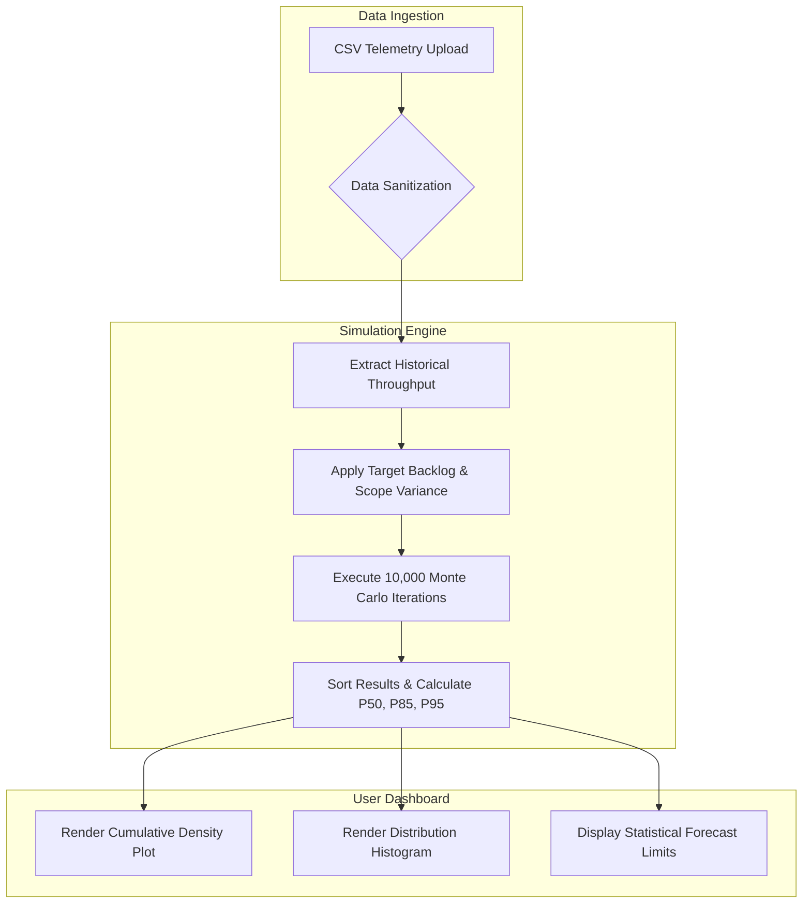

# Specialized Technology: Monte Carlo Simulation

## Concepts and How It Works
Monte Carlo simulation is a computational technique used to model the probability of different outcomes in a process that cannot easily be predicted due to the intervention of random variables. Instead of relying on a single average number to predict the future, it uses repeated random sampling to generate a wide range of possible outcomes. 

In the context of Agile software development, it is used to forecast project completion dates. At a basic level, the system takes historical data (how many tasks a team finished in past sprints) and randomly selects values from that data. It runs thousands of simulated scenarios essentially "playing out" the future of the project 10,000 times. By recording the results of all these simulations, it builds a probability distribution that shows exactly how likely a team is to finish their backlog by a specific sprint.

**Worked Example**
Assume a team needs to finish a backlog of 40 items. Their historical throughput for the last 5 sprints is `[5, 8, 4, 7, 6]` items completed per sprint.
*   **Iteration 1:** The engine randomly pulls "4, 6, 8, 4, 7, 6, 5" (totaling 40). The result is 7 sprints.
*   **Iteration 2:** The engine randomly pulls "4, 4, 5, 5, 4, 6, 4, 8" (totaling 40). The result is 8 sprints.
*   *The engine repeats this process 10,000 times.*
*   **Output:** The system groups the results to find confidence intervals, discovering that 85% of all 10,000 simulations finished in 9 sprints or fewer.

## Methods and Tools
1. **The Monte Carlo Method:** The core stochastic mathematical model used to simulate thousands of possible future project trajectories by resampling historical data.
2. **Absolute Flow Metrics:** The practice of utilizing exact, objective counts of completed work items per sprint rather than subjective human estimates like "Story Points."
3. **Rolling-Origin Backtesting:** A rigorous testing framework used to evaluate the simulation's accuracy by feeding older historical data into the simulation to predict future known outcomes.
4. **Python & Array Programming:** The core simulation engine is built in Python 3.11 leveraging the NumPy and Pandas libraries for high-performance, vectorized pseudo-random sampling.

## Fit to the Problem
**How it Addresses the Problem**
Monte Carlo simulation directly solves the problem of inaccurate Agile forecasting by accounting for the inherent variance, bottlenecks, and delays in software development. 
*   **Benefit:** It eliminates the "Flaw of Averages". Instead of forcing a team to commit to a highly rigid and risky single date, it allows project managers to communicate delivery dates mathematically attached to specific statistical confidence levels (e.g., an 85% or 95% likelihood).

## Limitations
1. **Garbage In, Garbage Out (GIGO):** The model strictly relies on past performance as a predictor of future performance. If the input data is missing, poorly tracked, or the team undergoes major structural changes, the historical data ceases to be representative, and the forecast will fail.
2. **Independence Assumption:** Standard bootstrap resampling assumes that weekly throughputs are independent events. In practice, software dependencies can create autocorrelated delays where one blocked week increases the likelihood of subsequent blocked weeks.
3. **Unmapped Black Swan Events:** Statistical sampling from a limited historical window cannot account for unprecedented systemic disruptions (e.g., enterprise restructuring or major outages) unless explicitly injected into scope parameters.

## Alternative Approach
Deterministic Forecasting is the most common alternative to probabilistic simulation. This approach is based on a best guess as to the size of the backlog items, typically in Story Points, and dividing the sum of the remaining points by the team's historical rate of working (velocity). For instance, if the velocity is 10 points/sprint and the backlog has 40 points, the calculation is 40/10 = 4 sprints, which offers a fixed answer.

Deterministic forecasting may be easier to compute and doesn't need any special software, but it's inherently wrong for knowledge work. It sees software development as a perfectly uniform manufacturing process, concealing all the risks and variabilities. Monte Carlo is selected over deterministic forecasting because it is a method that allows for the appropriate representation of uncertainty in the real world and development of realistic and risk adjusted expectations of stakeholders.

**Chosen Approach**
The **Monte Carlo approach** is the clear choice. Deterministic forecasting is fundamentally flawed because it treats complex knowledge work as a perfectly uniform manufacturing process. By utilizing Monte Carlo, the team can responsibly model real-world variability and establish realistic, risk-adjusted stakeholder expectations.

## System Workflow Diagram

